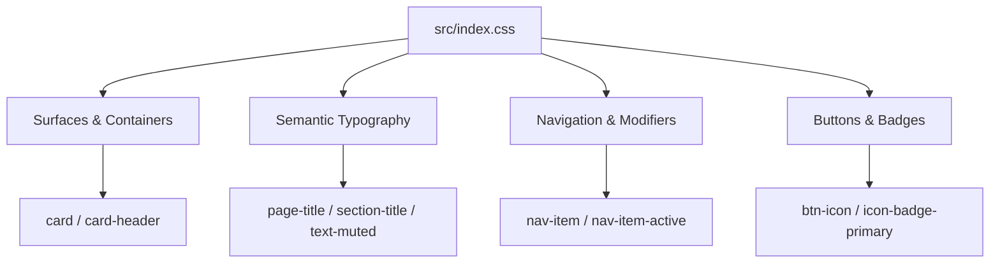

# Architecture & Styling Review: Tailwind CSS v4 Refactor

**Project:** Admin Dashboard Boilerplate  
**Stack:** React 19, TypeScript, Vite, Tailwind CSS v4.3.3, React Router v8, Lucide React  
**Date:** October 2026  
**Status:** Completed & Validated  

---

## 1. Executive Summary

This refactor transitioned the admin dashboard from repetitive, hardcoded Tailwind class strings to a centralized, semantic utility system powered by **Tailwind CSS v4 `@utility` directives**. 

### Primary Goals Achieved
- **Eliminated Repetition:** Replaced inline composite classes across layout components, dashboard widgets, and route pages.
- **Unified Light & Dark Theme Support:** Embedded theme variants directly into reusable utilities without duplicating layout rules.
- **Maintained Non-Breaking Architecture:** Preserved existing UI dimensions, responsive behaviors, and React Router logic without installing third-party dependencies.
- **Tailwind v4 Native:** Leveraged modern v4 syntax (`@utility`) instead of outdated Tailwind v3 configs or `@layer components`.

---

## 2. Design System Architecture

All shared utilities are defined as a single source of truth in [`src/index.css`](file:///c:/Users/Mayank/Documents/BoilerPlate%20Project/admin/src/index.css).



### Core Utility Directory

| Utility Class | Purpose | Definitions / Inherited Classes |
|---|---|---|
| `card` | Primary container surface | `rounded-xl border border-gray-200 bg-white shadow-sm dark:border-gray-800 dark:bg-gray-900` |
| `card-header` | Card header divider | `border-b border-gray-200 px-5 py-4 dark:border-gray-800` |
| `page-title` | Top-level page headings (h1) | `text-2xl font-bold text-gray-800 dark:text-white` |
| `section-title` | Section / modal / card headers (h2) | `text-lg font-semibold text-gray-800 dark:text-white` |
| `text-muted` | Secondary descriptions and subtitles | `text-sm text-gray-500 dark:text-gray-400` |
| `btn-icon` | Accessible icon-only action buttons | `rounded-lg p-2 text-gray-600 transition-colors hover:bg-gray-100 dark:text-gray-300 dark:hover:bg-gray-800` |
| `nav-item` | Sidebar navigation base links | `flex items-center gap-3 rounded-lg px-3 py-2 text-gray-600 transition-colors hover:bg-gray-100 dark:text-gray-300 dark:hover:bg-gray-800` |
| `nav-item-active` | Active sidebar navigation modifier | `bg-blue-50 text-blue-600 hover:bg-blue-50 dark:bg-blue-950 dark:text-blue-400 dark:hover:bg-blue-950` |
| `icon-badge-primary` | Brand icon container | `rounded-lg bg-blue-50 p-3 text-blue-600 dark:bg-blue-950 dark:text-blue-400` |
| `text-heading-1` | Backward-compatible alias for `page-title` | `page-title` |
| `text-heading-2` | Backward-compatible alias for `section-title` | `section-title` |

---

## 3. Before vs. After Code Comparison

### 3.1 Sidebar Navigation Links ([`src/components/layout/Sidebar.tsx`](file:///c:/Users/Mayank/Documents/BoilerPlate%20Project/admin/src/components/layout/Sidebar.tsx))

**Before (Duplicating layout in both ternary branches):**
```tsx
<NavLink
  to="/"
  className={({ isActive }) =>
    `flex items-center gap-3 rounded-lg px-3 py-2 ${
      isActive
        ? "bg-blue-50 text-blue-600 dark:bg-blue-950 dark:text-blue-400"
        : "text-gray-600 hover:bg-gray-100 dark:text-gray-300 dark:hover:bg-gray-800"
    }`
  }
>
  <LayoutDashboard size={20} />
  <span>Dashboard</span>
</NavLink>
```

**After (Clean modifier pattern):**
```tsx
<NavLink
  to="/"
  className={({ isActive }) =>
    `nav-item ${isActive ? "nav-item-active" : ""}`
  }
>
  <LayoutDashboard size={20} />
  <span>Dashboard</span>
</NavLink>
```

---

### 3.2 Metric Card ([`src/components/dashboard/StatCard.tsx`](file:///c:/Users/Mayank/Documents/BoilerPlate%20Project/admin/src/components/dashboard/StatCard.tsx))

**Before:**
```tsx
<div className="rounded-xl border border-gray-200 bg-white p-5 shadow-sm dark:border-gray-800 dark:bg-gray-900">
  <div className="flex items-start justify-between">
    <div>
      <p className="text-sm text-gray-500 dark:text-gray-400">{title}</p>
      <h3 className="mt-2 text-2xl font-bold text-gray-800 dark:text-white">{value}</h3>
    </div>
    <div className="rounded-lg bg-blue-50 p-3 text-blue-600 dark:bg-blue-950 dark:text-blue-400">
      <Icon size={22} />
    </div>
  </div>
...
```

**After:**
```tsx
<div className="card p-5">
  <div className="flex items-start justify-between">
    <div>
      <p className="text-muted">{title}</p>
      <h3 className="mt-2 page-title">{value}</h3>
    </div>
    <div className="icon-badge-primary">
      <Icon size={22} />
    </div>
  </div>
...
```

---

### 3.3 Orders Section ([`src/components/dashboard/RecentOrders.tsx`](file:///c:/Users/Mayank/Documents/BoilerPlate%20Project/admin/src/components/dashboard/RecentOrders.tsx))

**Before:**
```tsx
<section className="overflow-hidden rounded-xl border border-gray-200 bg-white shadow-sm dark:border-gray-800 dark:bg-gray-900">
  <div className="border-b border-gray-200 px-5 py-4 dark:border-gray-800">
    <h2 className="text-lg font-semibold text-gray-800 dark:text-white">Recent Orders</h2>
    <p className="mt-1 text-sm text-gray-500 dark:text-gray-400">A list of your latest customer orders.</p>
  </div>
```

**After:**
```tsx
<section className="card overflow-hidden">
  <div className="card-header">
    <h2 className="section-title">Recent Orders</h2>
    <p className="mt-1 text-muted">A list of your latest customer orders.</p>
  </div>
```

---

### 3.4 Page Titles ([`Dashboard.tsx`](file:///c:/Users/Mayank/Documents/BoilerPlate%20Project/admin/src/pages/Dashboard.tsx), [`Users.tsx`](file:///c:/Users/Mayank/Documents/BoilerPlate%20Project/admin/src/pages/Users.tsx), [`Settings.tsx`](file:///c:/Users/Mayank/Documents/BoilerPlate%20Project/admin/src/pages/Settings.tsx))

**Before:**
```tsx
<h1 className="text-2xl font-bold text-gray-800 dark:text-white">Users</h1>
<p className="mt-2 text-gray-500 dark:text-gray-400">Manage your users here.</p>
```

**After:**
```tsx
<h1 className="page-title">Users</h1>
<p className="mt-2 text-muted">Manage your users here.</p>
```

---

## 4. Verification & Quality Assurance

### 4.1 Linting
Executed `npm run lint`:
- **Result:** Code 0
- **Errors:** 0
- **Warnings:** 0

### 4.2 TypeScript & Production Bundle
Executed `npm run build`:
- **Result:** Code 0
- **Time:** ~740ms
- **Output:** Clean production bundle with CSS compiled to `dist/assets/index-*.css`.

### 4.3 Browser E2E Testing
Automated browser testing confirmed:
1. **Light / Dark Mode Switching:** The header toggle switch toggles `.dark` on `<html>`. Backgrounds, text contrast, borders, and hover states adapt smoothly.
2. **Navigation Flow:** Verified client-side navigation between `/`, `/users`, and `/settings`.
3. **Mobile Drawer:** Tested at viewport width `375px`. The sidebar properly hides off-canvas and the hamburger toggle expands and collapses the drawer with overlay.
4. **Desktop Layout:** Tested at `1280px`. The sidebar stays fixed at `w-64` and the main content renders with `ml-64`.

---

## 5. Architectural Principles Followed

1. **No Over-Abstraction:**  
   Component-specific layouts (e.g. table columns, responsive padding `p-4 sm:p-6`, flex alignments) were left directly in JSX. Only shared visual patterns were elevated to utilities.
2. **No Conflict Between Base and Active Nav States:**  
   `nav-item` controls layout and inactive colors; `nav-item-active` modifies the active colors without redefining padding, flex layout, or border radius.
3. **Clean Separation of Concerns:**  
   Status badges retain their component-level variant map (`statusStyles: Record<Status, string>`) in [`StatusBadge.tsx`](file:///c:/Users/Mayank/Documents/BoilerPlate%20Project/admin/src/components/ui/StatusBadge.tsx) rather than bloating the global CSS sheet.

---

## 6. Recommendations for Future Scaling

1. **Form Controls Utility Suite:**  
   When building out the [`Settings.tsx`](file:///c:/Users/Mayank/Documents/BoilerPlate%20Project/admin/src/pages/Settings.tsx) form or User modal, add `@utility input-text` and `@utility label` to maintain consistent borders, focus rings, and placeholder colors in dark mode.
2. **Tabular Primitives:**  
   If multiple data tables are introduced, extract a reusable `<Table>` component or `@utility table-th` / `@utility table-td` classes.
3. **Native CSS Custom Property Binding:**  
   If brand colors (currently `blue-600`) need to be dynamically customizable by the end user at runtime, map Tailwind v4 theme variables to `:root` CSS variables.
